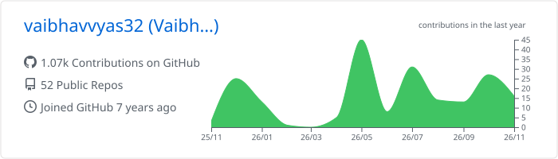
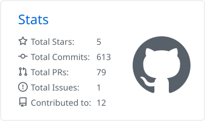
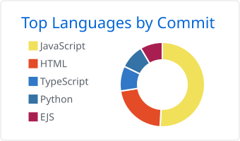

<!-- Header -->

  

  

  
  
  
  

---

## 👋 About me

I'm a **Full Stack Software Developer** with 2+ years of experience shipping production web apps with **React.js, Next.js, Node.js, Express.js, MongoDB and Python/Django**. I like owning features end to end, from the data model and REST APIs to a responsive, polished UI.

- 💼 **Now:** Software Developer at **Otulia** (Dubai, remote), a luxury marketplace for cars, real estate and yachts
- 🧱 Built Otulia's **blog CMS** (JWT + admin RBAC), a **threaded comments API**, and the **Rankings** and **Journal** sections
- ⚡ Previously at **Cognix (BITS Pilani)**: redesigned the backend and **cut response latency by 70%** for 1,500+ users on AWS EC2
- 📱 Side project: **[Ghar Hisaab](https://github.com/vaibhavvyas32/Ghar-Hisaab)**, an offline Android app for household bills
- 🎓 M.E. Computer Science, Thapar Institute of Engineering & Technology (2025)
- 🌱 Exploring backend system design and AI agents

---

## 🛠️ Tech stack

   
   
  

---

## 🚀 Featured projects

### 🏠 [Ghar Hisaab](https://github.com/vaibhavvyas32/Ghar-Hisaab)

**Keep a clean record of your milkman, dry cleaning and ironing (press), and know exactly what you owe each month.**
It replaces the paper calendar on the fridge: one tap a day, and the monthly bill adds itself up.

  

- 🥛 Milk delivery tracked like attendance, with per-day quantity changes and price history that never rewrites past months
- 👔 Dry clean and press logs with your own clothes types and prices, and a monthly breakdown by type
- 🔒 Works fully offline with no account or server; backup and restore via WhatsApp, Drive or a file

&nbsp;[**⬇️ Download the APK**](https://github.com/vaibhavvyas32/Ghar-Hisaab/releases/latest)

<table>
  <tr>
    <td width="50%" valign="top">
      <h3>📊 <a href="https://github.com/vaibhavvyas32/upi-analyzer">UPI Transaction Pattern Analyzer</a></h3>
      
Full-stack analytics platform that turns raw UPI transaction records into structured financial insights and expense reports, with automated parsing, categorization and merchant-level spending breakdowns.

      
      
    </td>
    <td width="50%" valign="top">
      <h3>📜 <a href="https://cert-portal-iota.vercel.app/">Certificate Portal</a></h3>
      
Template-driven PDF certificate generator using pdf-lib and MongoDB, with 20+ configurable placeholders, JWT + bcrypt auth and role-based access. Cut certificate creation from minutes to <b>under 10 seconds</b>.

      
      
      
    </td>
  </tr>
</table>

---

## 💼 Experience

| Role | Company | When | Highlights |
|---|---|---|---|
| **Software Developer** | Otulia, Dubai (remote) | Apr 2026 – Present | Shipped 3 production modules on the MERN stack; blog CMS secured with JWT + RBAC; threaded comments API; 54 UI components made responsive |
| **Software Developer** | Cognix (BITS Pilani), Hyderabad | Aug 2024 – Dec 2025 | 70% lower backend latency; account security for 1,500+ users; AWS EC2 deployments; 25+ REST endpoints validated |

---

## 📈 GitHub activity

  <picture>
    <source media="(prefers-color-scheme: dark)" srcset="./profile-summary-card-output/github_dark/0-profile-details.svg" />
    
  </picture>

  <picture>
    <source media="(prefers-color-scheme: dark)" srcset="./profile-summary-card-output/github_dark/3-stats.svg" />
    
  </picture>
  <picture>
    <source media="(prefers-color-scheme: dark)" srcset="./profile-summary-card-output/github_dark/2-most-commit-language.svg" />
    
  </picture>

  <picture>
    <source media="(prefers-color-scheme: dark)" srcset="https://streak-stats.demolab.com?user=vaibhavvyas32&theme=github-dark-blue&hide_border=true" />
    
  </picture>

### 🟩 Contribution chart

  

  <picture>
    <source media="(prefers-color-scheme: dark)" srcset="https://raw.githubusercontent.com/vaibhavvyas32/vaibhavvyas32/output/github-snake-dark.svg" />
    
  </picture>

---

  <b>Open to full-stack and software developer roles.</b> Let's talk: <a href="mailto:vaibhavvyas32@gmail.com">vaibhavvyas32@gmail.com</a>

  

